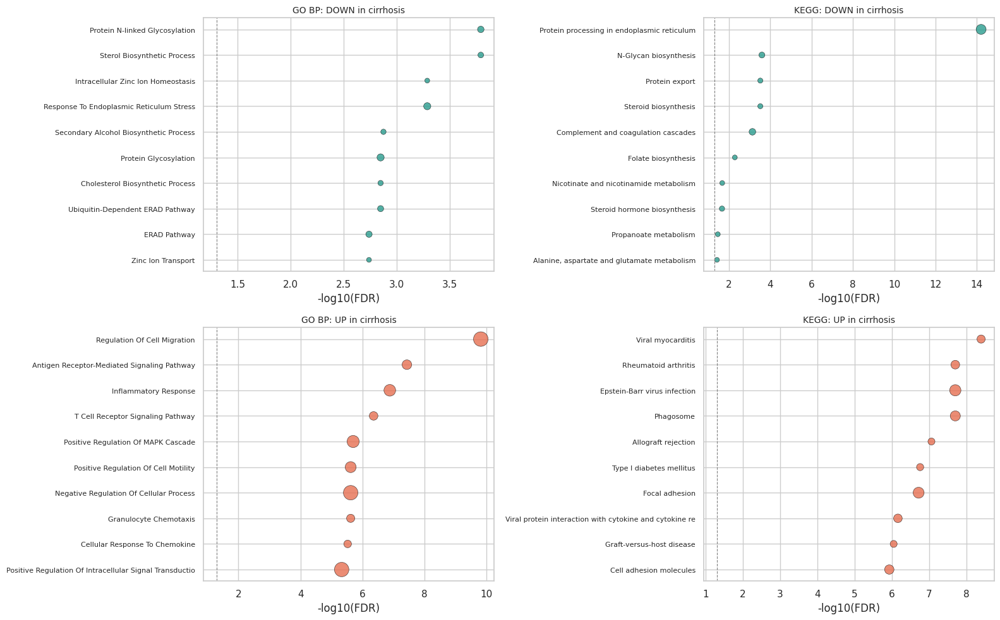
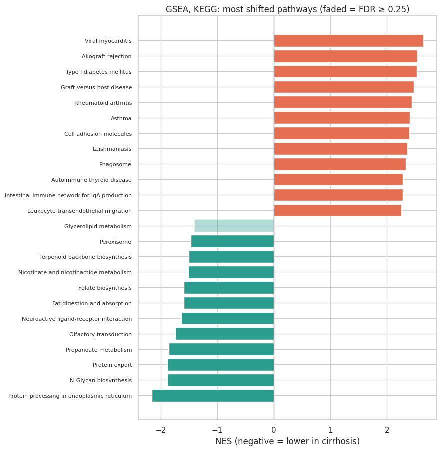
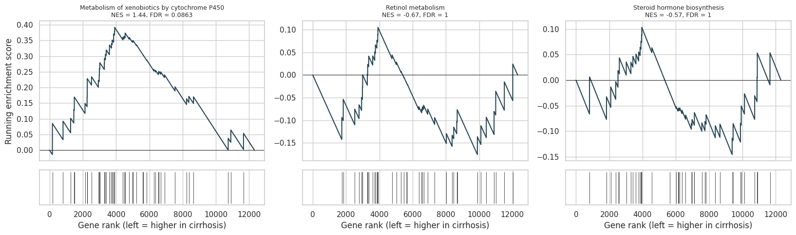
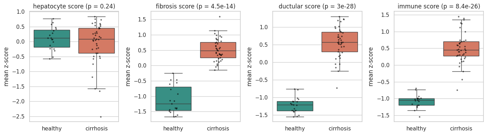

## Deployment URL
https://cirrhosis-cyp-expression-1.onrender.com/ 
## Selected Research Question:
"Do genes responsible for first-pass drug metabolism (such as CYP enzymes) show
significantly lower expression in cirrhotic livers compared to healthy livers?"
## Target Dataset Source:
NCBI GEO (Gene Expression Omnibus) – Microarray/RNA-seq gene expression matrices
comparing healthy human liver tissue against cirrhotic liver tissue.
## Project Objectives:
1. To acquire and preprocess a public gene expression dataset comparing healthy and
cirrhotic human livers from NCBI GEO.
2. To explore and visualize the data by comparing the expression levels of key
drug-metabolizing genes (such as CYP3A4) across healthy and diseased samples.
3. To train and evaluate a machine learning classification model to predict liver tissue
states based on these metabolic gene profiles.
4. To interpret the results and conclude how liver cirrhosis impacts drug-metabolizing
gene expression and first-pass metabolic capacity.
### GEO Candidate Dataset Evaluation Summary

| GEO Accession | Platform | Total Samples | Healthy Controls ($n$) | Cirrhosis Samples ($n$) | Confounding Groups / Exclusions | Meets $\ge 15$ Per Group Rule? | Verdict |
| :--- | :--- | :---: | :---: | :---: | :--- | :---: | :--- |
| **GSE14323** | GPL571 (HCC subset also on GPL96) | 124 | **19** | **58** | 47 liver tissues with HCC (can be filtered) | **Yes** | **Selected** — Best sample balance & clear non-tumor subset. |
| **GSE139602** | GPL13667 | 39 | 6 | 20 | 5 eCLD, 8 ACLF; progressive disease staging | **No** | *Underpowered* — Healthy control group ($n=6$) is too small. |
| **GSE25097** | GPL10687 | 557 | 6 | 40 | 268 tumor, 243 non-tumor | **No** | *Underpowered* — Healthy control group ($n=6$) is too small. |
| **GSE6764** | GPL570 | 75 | 10 | 13 | 52 dysplasia / HCC stages | **No** | *Underpowered* — Neither group reaches $n=15$. |

## Project Progress and Roadmap

| Stage | Description | Status | Key Deliverables |
| :--- | :--- | :--- | :--- |
| Stage 1 | Research Question Definition | Done | Formulated hypothesis on CYP gene downregulation in cirrhotic livers. |
| Stage 2 | Dataset Selection | Done | Selected GSE14323 (19 healthy, 58 cirrhosis). After removing HCC samples, 41 cirrhosis samples are analysed. |
| Stage 3 | Preprocessing and QC | Done | Filtered low-variance probes (22,277 down to 20,049). |
| Stage 4 | Probe-to-Gene Mapping | Done | 12,316 unique genes (highest-mean probe kept per gene). |
| Stage 5 | Visualization, EDA & Differential Expression | Done | EDA figures `eda1`–`eda6`. Welch t-test + BH FDR: 3 of 16 panel genes significantly lower (CYP2C19, CYP1A2, CYP2E1), 5 higher, 8 unchanged. |
| Stage 6 | Biological Interpretation | Done | ORA, GSEA, cell-composition check and clinical mapping. Figures `bioint1`–`bioint4`. See [Stage 6 results](#stage-6-biological-interpretation-results). |
| Stage 7 | Machine Learning | Pending | Pending |
| Stage 8 | Documentation | In progress | `PROJECT_SUMMARY.md`, `STAGE6_BIOLOGICAL_INTERPRETATION.md` |

## Stage 6: Biological Interpretation Results

| Question | Finding |
| :--- | :--- |
| Is drug metabolism lower as a whole pathway? | **No.** *Metabolism of xenobiotics by cytochrome P450* is shifted slightly **up** (GSEA NES +1.44, FDR 0.086). KEGG *Drug metabolism – cytochrome P450* and *– other enzymes* are missing from the Enrichr KEGG_2021 library, so they could not be tested. |
| What goes down in cirrhosis? | Hepatocyte protein-making and secretion (ER protein processing, ORA FDR 6e-15; N-glycan biosynthesis; protein export), cholesterol/steroid synthesis, complement and coagulation. |
| What goes up in cirrhosis? | Immune and inflammatory signalling (T-cell, antigen presentation, chemokines) and tissue remodelling (cell migration, focal adhesion). |
| Are the CYP drops just fewer liver cells? | **No.** The hepatocyte score does not differ between groups (p = 0.24). CYP2C19, CYP1A2 and CYP2E1 stay significantly lower after adjusting for it. Fibrosis, ductular and immune scores are much higher in cirrhosis (p < 1e-13). |

**Conclusion:** H1 is partly supported. Cirrhosis selectively lowers specific CYPs (CYP2C19, CYP1A2, CYP2E1) rather than shutting down drug metabolism as a whole. The wider picture is loss of hepatocyte synthetic function plus immune infiltration and fibrosis.

